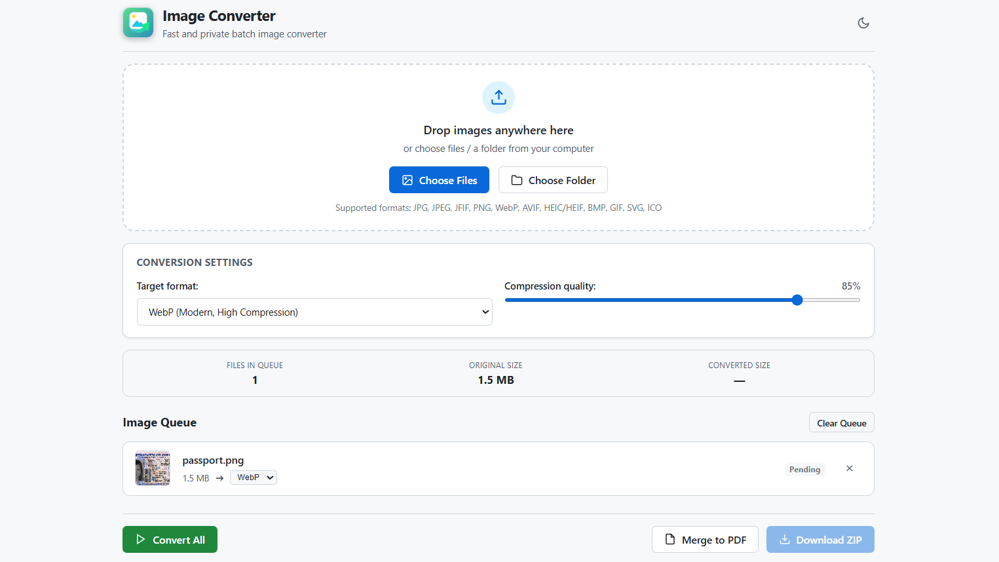

# Local Image Converter

A fast, private, and lightweight 100% client-side image converter and PDF merger. Convert photos, graphics, Apple HEIC, and scan documents directly in your browser without uploading files to any server.

🚀 **Live Web App**: [https://oprosvir.github.io/image-converter/](https://oprosvir.github.io/image-converter/)

---



---

## Repository Layout

```text
image-converter/
├── index.html           # Main semantic single-page application UI
├── logo.png             # Application logo & browser favicon
├── app.ico              # Multi-resolution Windows desktop shortcut icon
├── server.py            # Zero-dependency local Python HTTP launcher (Python 3 stdlib)
├── run.bat              # One-click launcher for Windows
├── run.sh               # One-click launcher for Linux and macOS
├── css/
│   └── styles.css       # Responsive dark/light theme stylesheet
└── js/
    ├── app.js           # UI controller, state management & Drag-and-Drop handling
    ├── converter.js     # Core client-side conversion & PDF generation engine
    ├── ico-encoder.js   # Client-side multi-frame ICO binary encoder
    ├── bmp-encoder.js   # Client-side 24-bit uncompressed BMP binary encoder
    └── vendor/          # Standalone offline vendor libraries:
        ├── jszip.min.js      # Client-side ZIP archive builder
        ├── jspdf.umd.min.js  # Client-side PDF generator
        └── heic2any.min.js   # WebAssembly Apple HEIC decoder
```

---

## Supported Formats

| Format | Recommended Use |
| :--- | :--- |
| **WebP** | Modern web standard, 30–80% smaller than JPEG at equal quality |
| **JPG / JPEG** | Universal compatibility across all legacy devices, photo printing |
| **JFIF** | Standard JPEG exchange format |
| **PNG** | Logos, screenshots, UI graphics, illustrations with transparency |
| **AVIF** | Next-generation ultra-compression format based on AV1 |
| **Apple HEIC / HEIF** | iPhone & iPad camera photos (decoded client-side via WebAssembly) |
| **ICO** | Windows desktop shortcuts & website favicons (16, 32, 48, 64, 128, 256 px) |
| **BMP** | Uncompressed | Raw Windows bitmap for legacy software, CNC & industrial equipment |
| **GIF** | Indexed | Simple graphics and legacy animations |
| **SVG** | Vector graphics and SVG icons converted to raster formats |
| **PDF** | Individual scan export or **Merge to PDF** (multi-page A4 document) |

---

## Quick Start

### Windows
1. Double-click **`run.bat`** (or use the desktop shortcut).
2. The application will start and automatically open in your default browser at `http://localhost:8000/`.
3. *(Alternative)*: You can also double-click **`index.html`** directly without running Python.

### Linux & macOS
1. Open terminal and run:
   ```bash
   ./run.sh
   ```
   *(Or simply run `python3 server.py`)*.
2. *(Alternative)*: Open `index.html` directly in your browser:
   ```bash
   xdg-open index.html   # Linux
   open index.html       # macOS
   ```

---

## Architecture & Privacy Model

* **Zero Backend Dependency**: `server.py` is merely a convenience script to serve static files over `localhost` using Python's standard `http.server`. It contains zero image processing logic.
* **Client-Side Rendering**: Image conversion runs via native browser APIs (`HTMLCanvasElement.toBlob()` and `OffscreenCanvas`).
* **Memory Management**: Images are stored temporarily in browser memory as `Blob` objects (`blob:http://...`). When you download, bytes are transferred directly from RAM to disk. Closing or refreshing the tab immediately purges all data from memory.
* **No Telemetry**: No tracking scripts, no third-party CDNs, and no external network calls.

---

## License

This project is open-source and available under the [MIT License](https://opensource.org/licenses/MIT).
